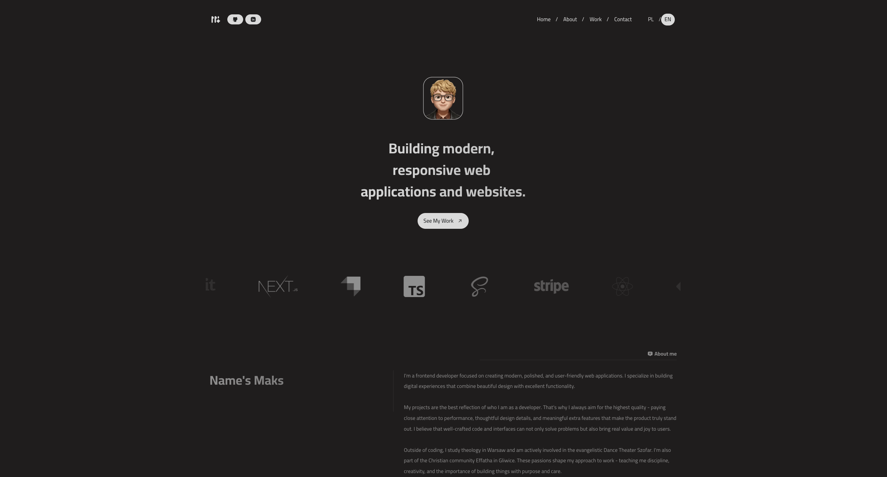
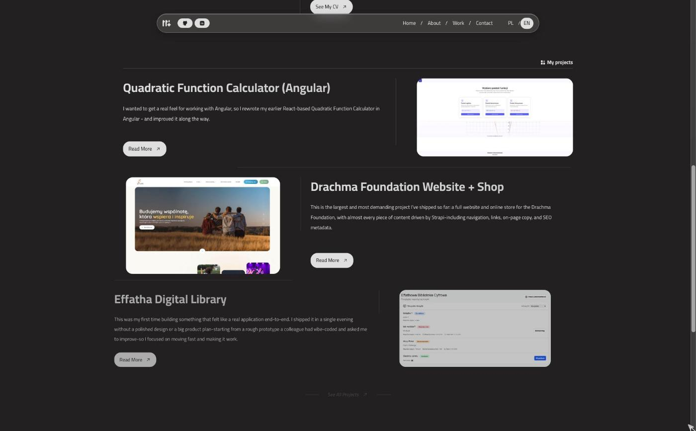

<h1>maxtkaczyk.pl · Portfolio</h1>

<p>
  <a href="https://www.maxtkaczyk.pl"></a>
</p>
<p>
  
  
  
  
  
  
</p>

My personal portfolio: who I am, what I build and how to reach me. Bilingual (🇵🇱 PL / 🇬🇧 EN), animated and built with attention to detail.



## Features

- **Bilingual:** Polish and English with `next-intl`, using locale-based routing (`/pl`, `/en`)
- **Projects section** with case-study dialogs and image galleries (PhotoSwipe, Swiper)
- **Contact form** validated with React Hook Form + Zod, sent with Nodemailer and rate-limited via Upstash Redis
- **Animations** built with Motion
- **SEO:** generated `sitemap` and `robots`
- Vercel Analytics and Speed Insights



## Tech stack

Next.js 16 (App Router) · React 19 · TypeScript · Tailwind CSS 4 + Sass · shadcn/ui (Base UI, Radix) · Motion · next-intl · React Hook Form + Zod · Nodemailer · Upstash Redis · Biome · Vercel

## Project structure

```
frontend/
├── messages/            # translations (pl.json, en.json)
├── src/app/
│   ├── [locale]/        # pages
│   ├── api/             # contact form + Upstash keepalive cron
│   ├── components/  UI/
│   ├── constants/       # project list (myProjects.ts)
│   └── assets/MyWork/   # project screenshots
```

Adding a new project to the portfolio is described step by step in [`frontend/README-PROJECTS.md`](./frontend/README-PROJECTS.md).

## Running locally

```bash
cd frontend
pnpm install
pnpm dev         # → http://localhost:3000
```

```bash
pnpm build       # production build
pnpm lint        # Biome
pnpm format
```

The contact form and rate limiting need environment variables (SMTP and Upstash credentials) in `frontend/.env.local`.

---

<sub>Designed and built by Maksymilian Tkaczyk</sub>
